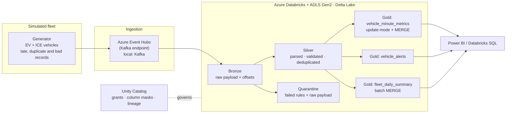

# Real-time Vehicle Telemetry Lakehouse

[](https://github.com/SykamVenkata/realtime-vehicle-telemetry-lakehouse/actions/workflows/ci.yml)

A streaming Lakehouse for connected-vehicle telemetry on Azure. A simulated
fleet streams readings into **Event Hubs**; **Databricks Structured Streaming**
lands them in **Delta Lake** Bronze, Silver and Gold tables with data quality
checks, deduplication and late-data handling; **Unity Catalog** governs access;
and **Power BI** shows the fleet live.

The whole pipeline also runs on a laptop with one command (`make up`), using
Kafka in place of Event Hubs.

## Architecture



## What it demonstrates

| Area | How |
| --- | --- |
| Streaming ingestion | Spark Kafka source reading Event Hubs over SASL_SSL; Bronze keeps the raw payload, partition and offset for replay |
| Late data | Event-time processing with watermarks; late readings correct their minute in Gold |
| Exactly-once results | Checkpointed streams, `dropDuplicatesWithinWatermark` on `event_id`, idempotent `MERGE` upserts |
| Data quality | 13 rules defined once ([quality.py](src/telemetry/quality.py)); bad records go to a quarantine table with the rules they broke |
| Live serving | Update-mode aggregation upserted with `MERGE`, so each minute appears within one trigger |
| Governance | Unity Catalog external location, schema-level grants, column masks on GPS coordinates |
| Performance | Date partitioning, compaction, Z-Order by `vehicle_id`, vacuum |
| Infrastructure as code | Terraform for Event Hubs, ADLS Gen2, Databricks and the Unity Catalog access connector |
| Deployment | Databricks Asset Bundle for the streaming and daily jobs |
| Testing and CI | Unit tests plus Spark tests on GitHub Actions, including a check that Spark and Python quality rules agree |

## Run it locally in 3 commands

Needs Docker with about 6 GB of memory.

```bash
git clone https://github.com/SykamVenkata/realtime-vehicle-telemetry-lakehouse.git
cd realtime-vehicle-telemetry-lakehouse
make up      # Kafka + generator (500 vehicles) + Bronze, Silver and Gold streams
```

After a couple of minutes:

```bash
make show        # row counts per layer, quarantine reasons, latest metrics, alerts, latency
make demo-batch  # daily summary + compaction, Z-Order and vacuum
make down        # stop (data stays in ./data)
```

## Deploy to Azure

`infra/terraform` provisions Event Hubs, ADLS Gen2, a Premium Databricks
workspace and a Unity Catalog access connector; `databricks.yml` deploys the
jobs. Step-by-step guide: **[docs/azure-deployment.md](docs/azure-deployment.md)**.

<!--
Results from an Azure run (fill in after deploying):
| Metric | Value |
| Sustained input rate | ___ events/s |
| p50 / p95 delay, vehicle to Silver | ___ s / ___ s |
| Micro-batch duration | ___ s |
Screenshots: docs/img/dashboard.png, docs/img/spark-ui.png
-->

## Data model

| Layer | Table | Grain | Notes |
| --- | --- | --- | --- |
| Bronze | `vehicle_telemetry_raw` | one Kafka message | raw JSON, topic, partition, offset, ingest time |
| Silver | `vehicle_telemetry` | one valid reading | typed, deduplicated, `energy_pct`, `ingest_delay_s` |
| Silver | `vehicle_telemetry_quarantine` | one rejected message | raw payload + `dq_failed_rules` |
| Gold | `vehicle_minute_metrics` | vehicle × minute | speed, temperature, energy, harsh brakes, km driven, last position |
| Gold | `vehicle_alerts` | one alert | high engine temperature, low battery, low fuel, harsh braking |
| Gold | `fleet_daily_summary` | day × powertrain | active vehicles, km, harsh brakes, vehicles with fault codes |

## Data quality rules

Every rule lives in [`src/telemetry/quality.py`](src/telemetry/quality.py) with a Spark SQL
expression (used by the Silver stream) and a Python predicate (used by the tests):

`event_id_present` · `vehicle_id_present` · `event_ts_valid` · `event_ts_not_future` ·
`powertrain_valid` · `powertrain_consistent` · `lat_in_range` · `lon_in_range` ·
`speed_in_range` · `engine_temp_in_range` · `battery_in_range` · `fuel_in_range` ·
`schema_version_supported`

The generator injects duplicates (1%), late readings 5 to 15 minutes old (2%) and
defective records (0.5%) so each of these paths is exercised continuously.

## Design decisions

Watermark sizes, quarantine versus drop, update mode with MERGE, partitioning
and cost: **[docs/design-decisions.md](docs/design-decisions.md)**.

## Repository layout

```
src/telemetry/        event contract, quality rules, generator, transforms, config
pipelines/            bronze_ingest · silver_cleanse · gold_stream · gold_daily_summary · maintenance
tests/                unit tests and Spark tests
infra/terraform/      Azure infrastructure
sql/                  Unity Catalog setup and dashboard queries
databricks.yml        Databricks Asset Bundle (jobs)
docker-compose.yml    local Kafka + pipeline
```

## Development

```bash
pip install -e ".[spark,producer,dev]"   # Spark tests also need Java 17
make test        # all tests
make test-fast   # pure-Python tests only
make lint
```

## About

Built by **Narendra Sykam**, Senior Azure Data Engineer.
Portfolio: [sykamsolutions.com/portfolio](https://sykamsolutions.com/portfolio/) ·
[LinkedIn](https://www.linkedin.com/in/venkatanksykam)

All data is synthetic. MIT licensed.
